# Phase 2 QA

Run on 2026-10-20 on the M1 Pro. QA.md §6 asks for:

- `cargo xtask qa`
- `cargo xtask qa-shots`
- a review of every frame PNG
- the live smoke run

Phase 2 has no TUI, so the scenarios drive the headless CLI through the PTY harness. No design artboard draws CLI output, so there is nothing for these frames to be compared against. The artboards were still rendered, so that Phase 3 has its reference images (one is shown at the end).

```
$ cargo xtask qa
qa: p2-errors: 5 frames
qa: p2-new-and-run: 2 frames
qa: p2-query: 3 frames
qa: p2-verify-doctor: 2 frames
test result: ok. 1 passed; 0 failed; 0 ignored; 0 measured; 0 filtered out; finished in 4.29s
$ cargo xtask qa-shots
...
12 frames, 10 artboards
```

I looked at every frame PNG listed below, after the fixes in "Bugs found". The images in this document are copies of those PNGs (`docs/phases/qa/phase-2/`).

## p2-new-and-run: new case, run a username seed (J6, Phase 2), 120×36

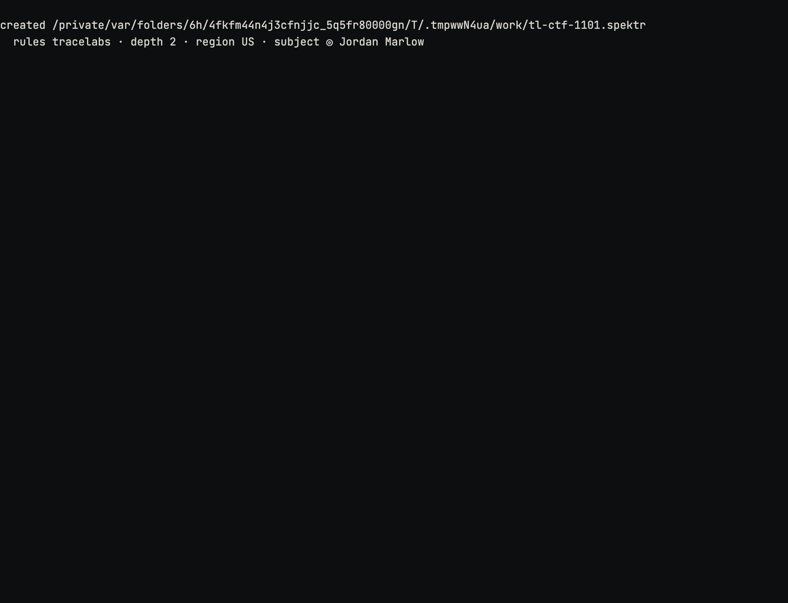
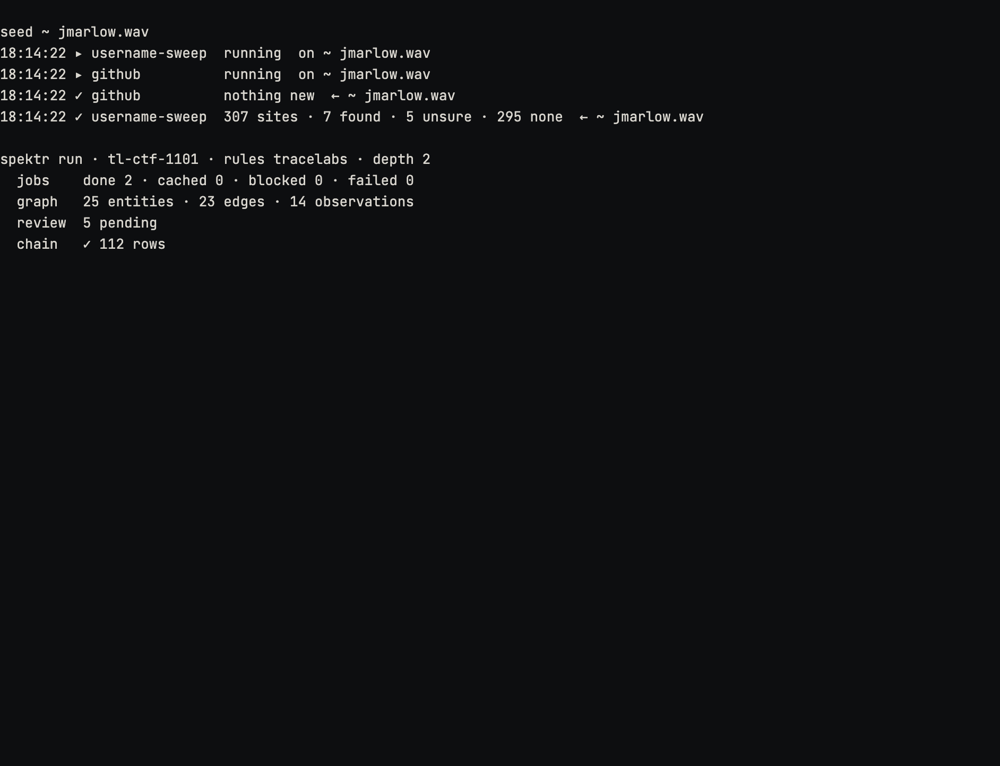

| Checklist item | Result |
|---|---|
| `new` prints the case path and one summary line (rules, depth, region, subject with the ◎ glyph) | Pass. `rules tracelabs · depth 2 · region US · subject ◎ Jordan Marlow` |
| Activity lines follow the rail format: HH:MM:SS, status glyph, module padded to 15, summary | Pass. `18:14:22 ▸ username-sweep  running  on ~ jmarlow.wav`; the module column is aligned across rows |
| The sweep line reads `307 sites · 7 found · 5 unsure · 295 none` and points at `~ jmarlow.wav` | Pass |
| The summary block's labels line up in one column; counts are plausible (7 accounts, 5 review items) | Pass, after the fix that separates the summary from the activity lines with a blank line (bug 3). `jobs`, `graph`, `review` and `chain` align |
| Nothing wraps or overflows at 120 columns; no stray escape sequences | Pass |

## p2-query: query tables, 120×36

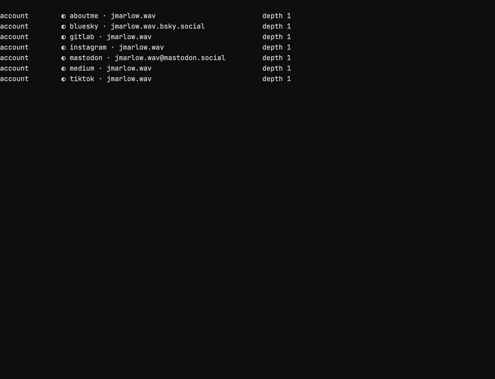
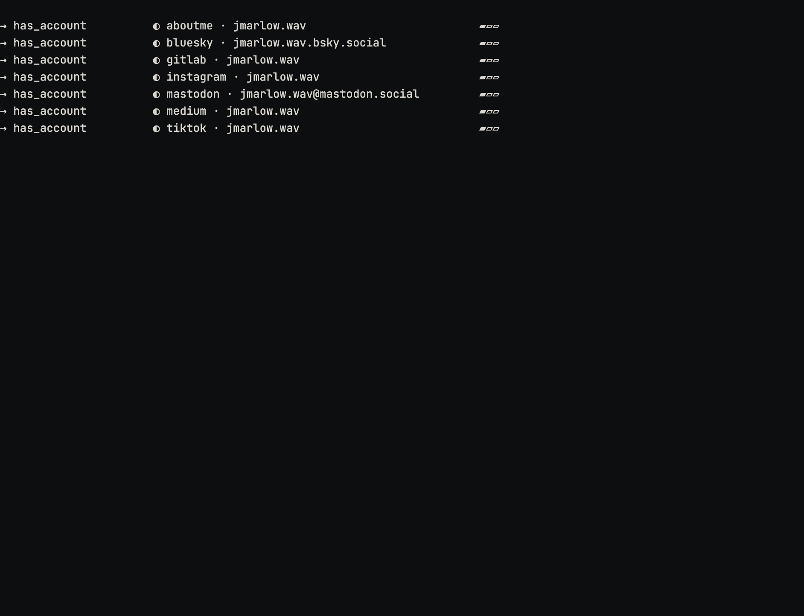
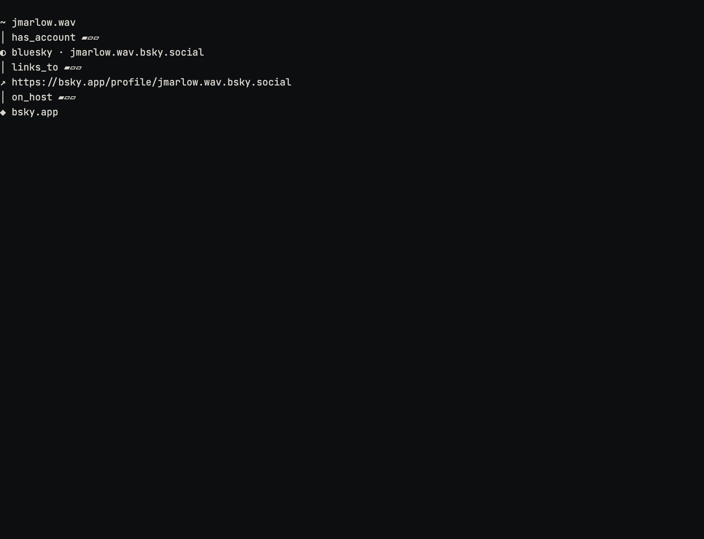

| Checklist item | Result |
|---|---|
| Account rows show the ◐ glyph and `platform · handle`, aligned in columns | Pass |
| Neighbour rows show direction arrows, predicate, entity and a three-segment strength bar (▰▱▱ for single) | Pass. The ▰▱ glyphs come from a fallback font in Chrome, exactly as in the artboard renders, so frames and artboards match |
| The path view draws entity / │ predicate bar / entity, ending at the domain | Pass. `~ jmarlow.wav` → `has_account` → `◐ bluesky · …` → `links_to` → `↗ https://bsky.app/…` → `on_host` → `◆ bsky.app` |
| Unicode glyphs (◐ ~ ↗ ◆ ▰ ▱ │) render single-width and don't misalign columns | Pass |

## p2-verify-doctor: verify and doctor, 120×36

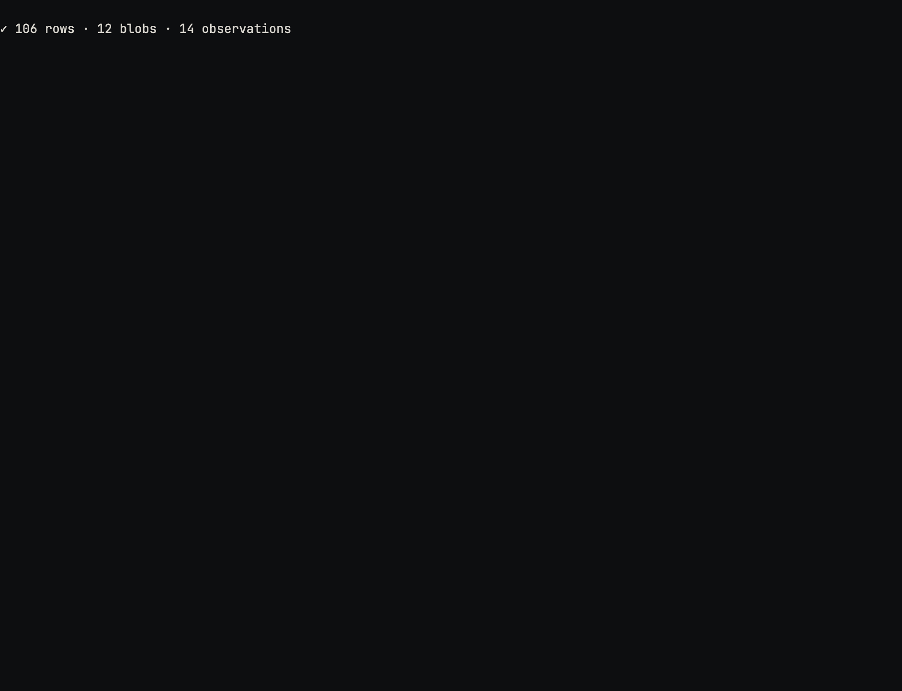
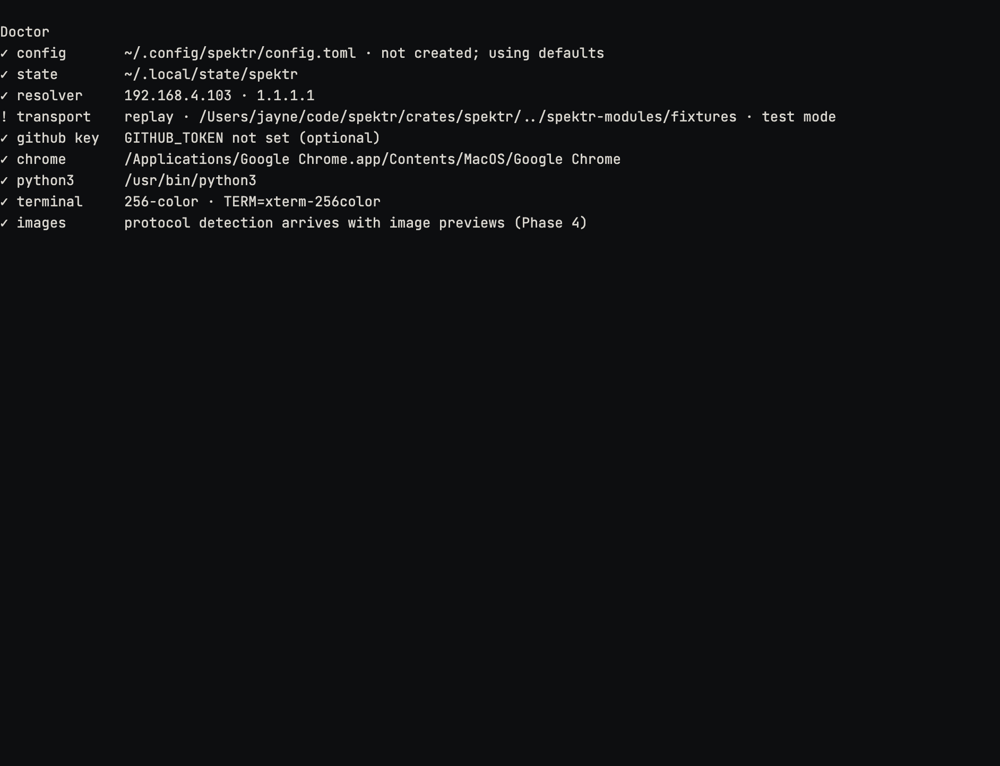

| Checklist item | Result |
|---|---|
| `verify` reports ✓ with row, blob and observation counts on one line | Pass. `✓ 106 rows · 12 blobs · 14 observations` |
| `doctor` lists one check per line: glyph (✓ ! ✕), a padded name, then the detail | Pass, after fix 2. The config path no longer wraps |
| Doctor shows the resolver, the test-mode transport warning (!), chrome/python3 and the terminal line | Pass. The transport line now reads `replay · <dir> · test mode` instead of Rust debug output (fix 2) |
| No secret values appear anywhere (only names, set/not set) | Pass. `GITHUB_TOKEN not set (optional)` |

## p2-errors: errors and usage, 100×30

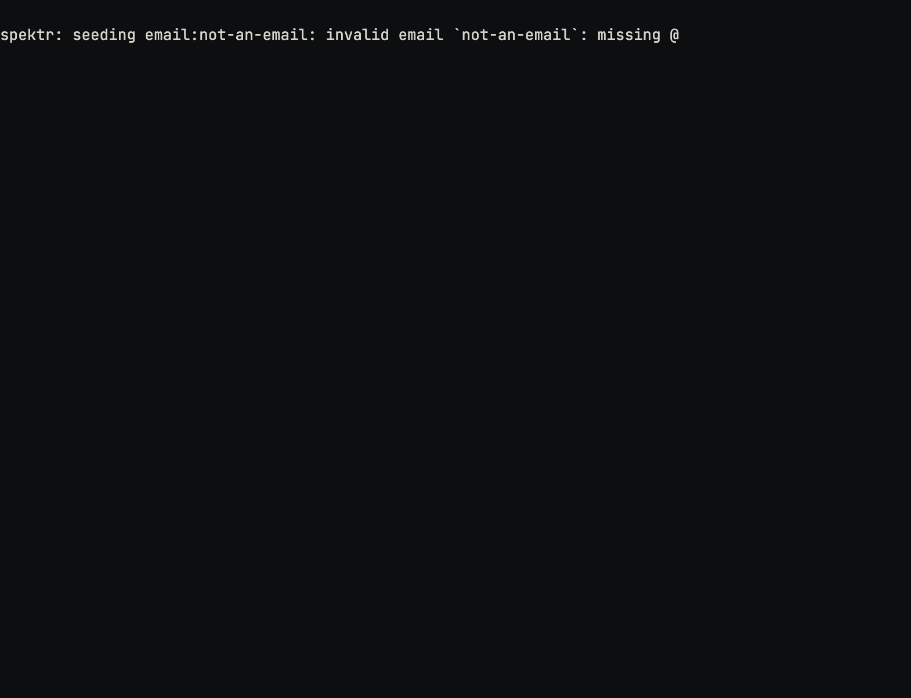
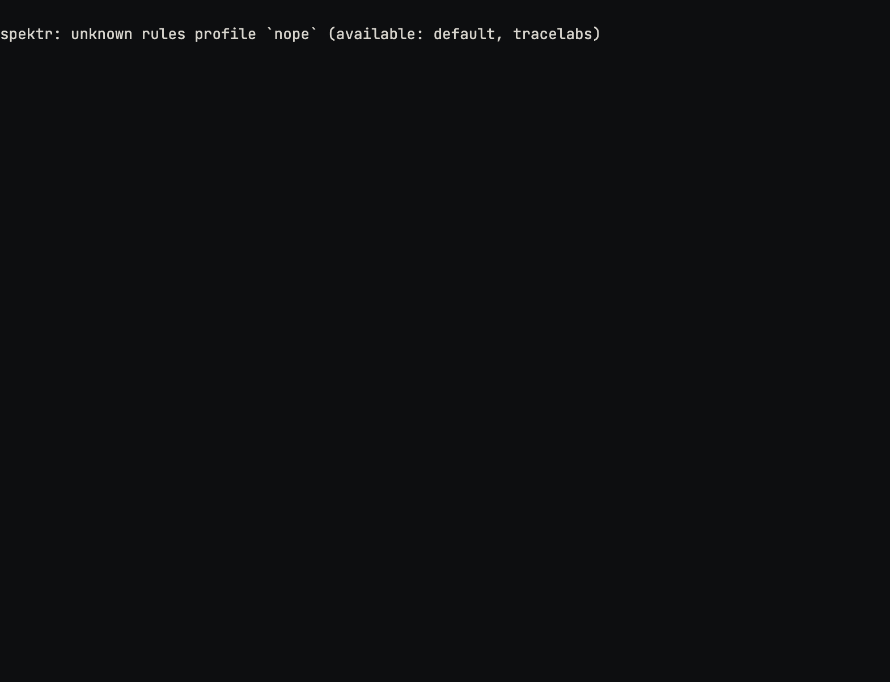
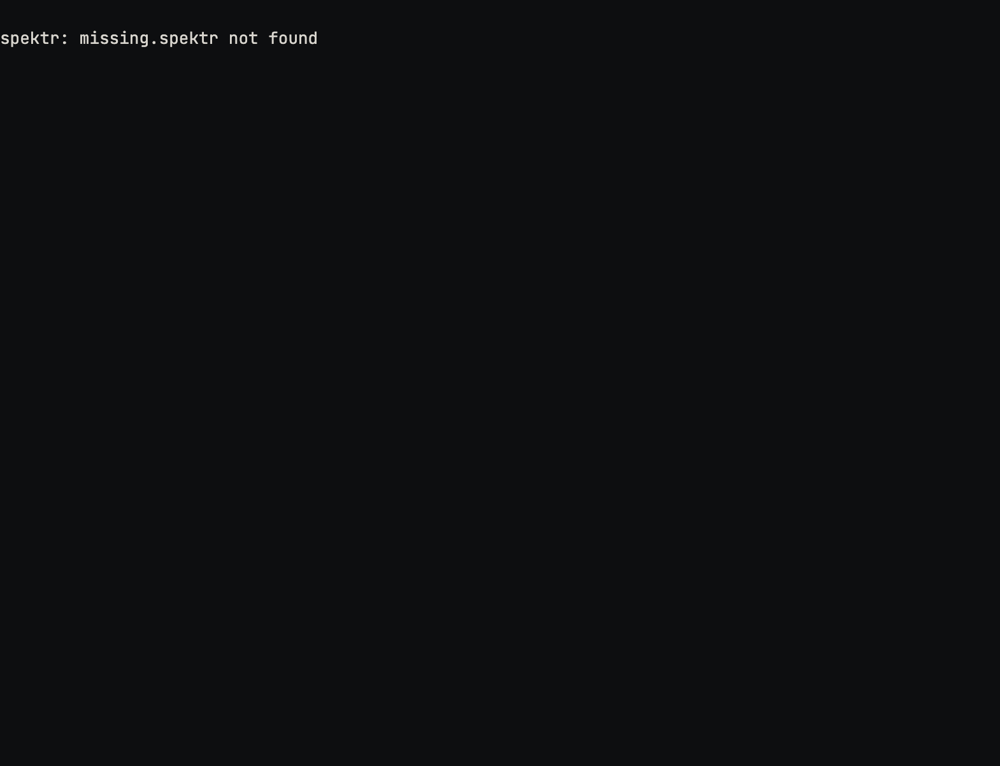
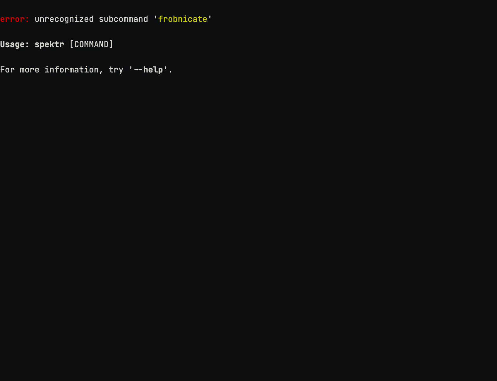
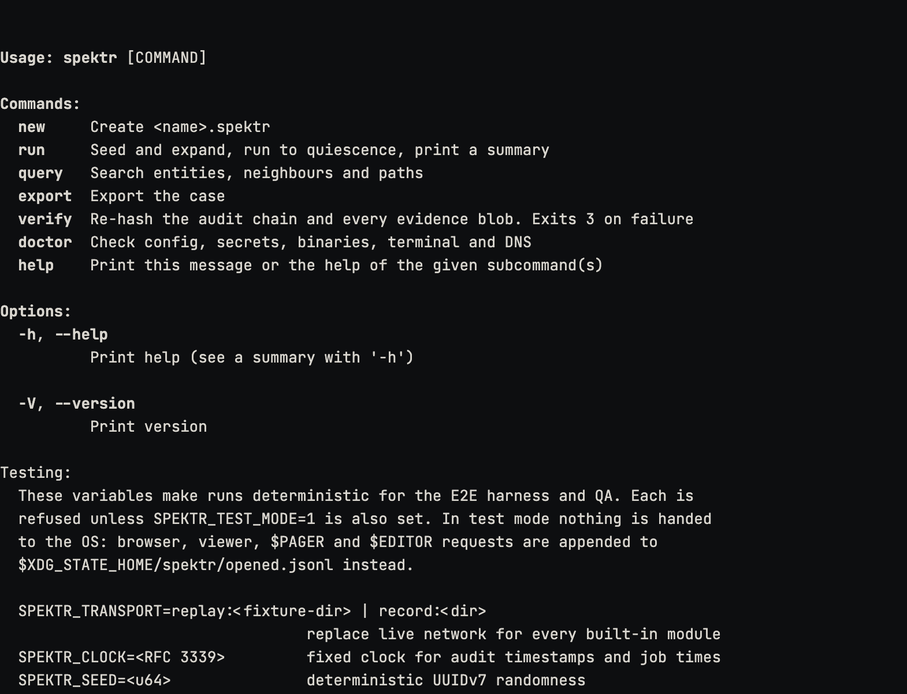

| Checklist item | Result |
|---|---|
| A bad seed names the problem and the input, exit 1 | Pass. `spektr: seeding email:not-an-email: invalid email \`not-an-email\`: missing @`; the harness asserted exit 1 |
| An unknown profile lists the available profiles, exit 1 | Pass. `(available: default, tracelabs)` |
| A missing case says `... not found`, exit 1 | Pass |
| Usage errors come from clap with a hint, exit 2 | Pass. Clap colours `error:` and the bad token; that is clap's own styling, not spektr's palette (TUI_SPEC §2 governs the TUI) |
| `--help` lists every Phase 2 command and the Testing section; it fits 100 columns | Pass for width. At 30 rows, the help's first lines (the about line) scroll out of the frame; the whole text was checked in `e2e_headless::testing_variables_need_test_mode` |

## Live smoke run

`qa/live-targets.toml` doesn't exist, so live runs cover `example.com` only (QA.md §4). The run used the `tracelabs` profile.

```
$ cargo xtask qa --live
# Live smoke run

Targets: domain:example.com (from the default: qa/live-targets.toml is missing or empty, so example.com only).

| Module | Target | Result | Latency | Detail | Response shape |
|---|---|---|---|---|---|
| dns | domain:example.com | ok | 284 ms | 4 addresses · 1 MX | matches fixtures (resolves_to ip) |

No emails approved; no Phase 2 module consumes email anyway.
No usernames approved: `github` and `username-sweep` were not run live.
```

What it wrote (`spektr query … --neighbors domain:example.com`):

```
→ resolves_to          ● 104.20.23.154                                  ▰▱▱
→ resolves_to          ● 172.66.147.243                                 ▰▱▱
→ resolves_to          ● 2606:4700:10::6814:179a                        ▰▱▱
→ resolves_to          ● 2606:4700:10::ac42:93f3                        ▰▱▱
```

- The MX answer is example.com's null MX (`0 .`, RFC 7505); the module correctly skips it.
- The addresses fall in Cloudflare ranges, so the known-hub list flags them.
- This is the first real use of spektr's own stub resolver (UDP, EDNS0, id and question matching) against a live recursive resolver.
- **Not run live:** `github` and `username-sweep`. They need an approved username, and the 307 sweep site rules are unverified (see PHASE_2_COMPLETE "Known issues").

## Bugs found

| # | Frame | Expected | Actual | Fix |
|---|---|---|---|---|
| 1 | every frame | One terminal row per 20 px line, as in the artboards | Every row was followed by a blank row: the newline between row `<div>`s rendered inside the `white-space: pre` container | `bb43bc3`: no whitespace between rows in the frame HTML |
| 2 | p2-verify-doctor/doctor | Paths fit 120 columns; readable transport line | The config path wrapped (`defaul` / `ts)`); the transport showed `Replay("/…")` | `bb43bc3`: `~`-abbreviated paths, `replay · <dir> · test mode` |
| 3 | p2-new-and-run/run | The summary block set apart from the activity lines | The summary ran straight on from the last activity line | `bb43bc3`: a blank line before the summary |
| 4 | artboard renders | Artboards as designed | Rows overlapped: the canvas relies on a `support.js` that isn't in the repo, so the whitespace between tags rendered as blank rows | `bb43bc3`: `qa-shots` renders a copy with that whitespace removed, at the canvas's own size |

Found by the tests rather than by QA review, and fixed before the phase closed:

- **Seeded id collision:** with `SPEKTR_SEED`, a second `spektr run` on a case repeated ids the first run had used. Fixed in `4cb41fd`.
- **`retryable: false` ignored:** an exec module's error was retried even though it set `retryable: false`. Fixed in `be366e8`, before that commit.

## Reference: an artboard render for Phase 3


